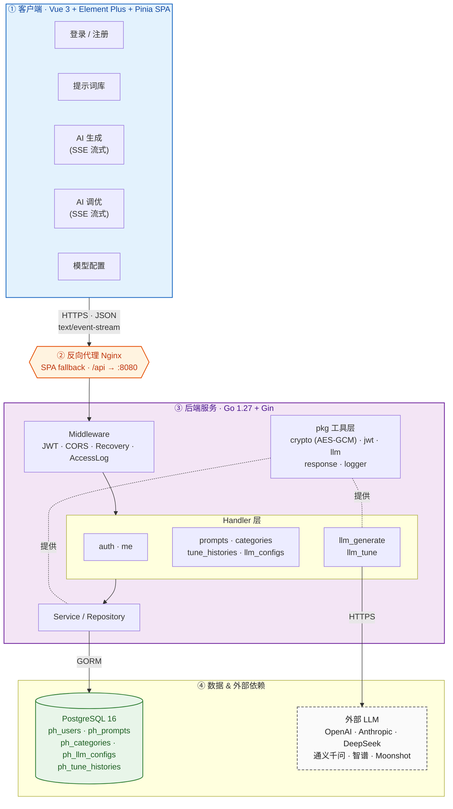
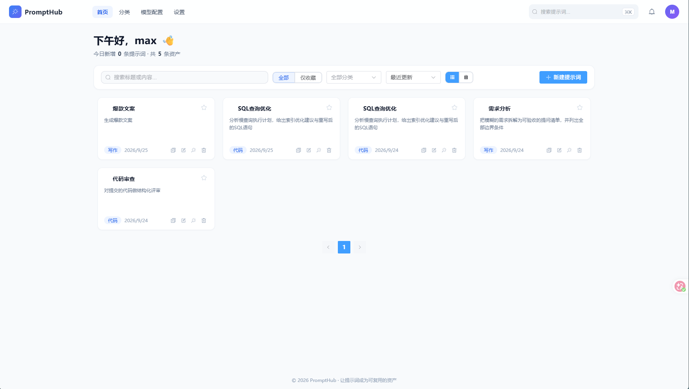
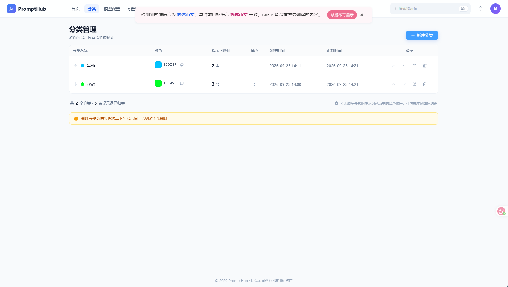

# PromptHub

> AI 提示词资产管理工具 · 个人全栈应用

PromptHub 是一个面向个人用户的 AI 提示词集中管理平台，提供提示词的**分类存储、AI 生成、AI 调优、版本历史、批量导出**等能力。所有功能围绕"个人使用 + 私有部署"设计：单一用户、本地数据库、可插拔的 LLM 提供商配置。


## 技术栈

| 层 | 技术选型 |
| --- | --- |
| 前端 | TypeScript + Vue 3 + Vite + Vue Router + Pinia + Element Plus + Axios |
| 后端 | Go 1.27 + Gin + GORM + Viper + Zap |
| 数据 | PostgreSQL 16（默认）/ MySQL 8.4（可选）；启动时 `AutoMigrate` 建表 |
| 实时 | SSE（fetch + ReadableStream），不走 axios |
| 安全 | JWT（access + refresh）、AES-GCM 加密 LLM API Key、bcrypt 密码、密钥文件持久化 |
| 部署 | Docker + Docker Compose + Nginx 反向代理 |
| 文档 | 中文，写入 `tasks/` 与各模块目录 |

## 技术架构图




## 界面截图

| 提示词库（首页） | 分类管理 |
| :---: | :---: |
|  |  |


## 核心功能

| 模块 | 状态 | 说明 |
| --- | --- | --- |
| 账户体系 | ✅ | 注册 / 登录 / 刷新令牌 / 登出 / 当前用户 / 修改昵称 / 修改密码（改密触发 `token_version` 强制下线其他设备） |
| 提示词管理 | ✅ | 列表（搜索/筛选/排序/收藏）、详情、创建、编辑、删除、批量删除、收藏切换；含 `version_no` 与可选分类、标签 |
| 分类管理 | ✅ | CRUD、按 sort 排序、聚合 `prompt_count`、有提示词引用时拒绝删除（409） |
| 大模型配置 | ✅ | 多供应商（OpenAI / Anthropic / DeepSeek / 通义千问 / 智谱 / Moonshot / 自定义）；API Key AES 加密存储；脱敏回显；设为默认；连接测试；拉取模型列表 |
| AI 生成 | ✅ | SSE 流式输出；输入用途描述 → 生成 `{title, content, description}`；支持风格 / 语言 / 模型选择 |
| AI 调优 | ✅ | SSE 流式输出；针对已有提示词改写；按版本号入库为调优历史；可一键回填并 `version_no++` |
| 健康检查 | ✅ | `/healthz` 包含数据库连通性 |

详见 [`docs/architecture.md`](./docs/architecture.md) 与 [`tasks/api.md`](./tasks/api.md)。

## 目录结构

```
prompt-hub/
├── README.md                 本文件 - 项目总览
├── AGENTS.md                 协作约定（commit / 分支 / 评审 / 安全）
├── docker-compose.yml        一键编排：postgres + backend + frontend
├── docs/                     架构与运维文档
│   ├── architecture.md       系统架构总览
│   └── screens/              参考截图
├── frontend/                 Vue3 前端（含独立 README.md / AGENTS.md）
│   ├── src/views/            页面：Login / Register / Prompts / PromptCreate / PromptDetail / PromptTune / Categories / Settings / LLMSettings / ProfileSettings / NotFound
│   ├── src/stores/           Pinia：user / category / prompt / tune / llm / app
│   ├── src/api/modules/      后端模块封装：auth / me / category / prompt / tune / llm / http
│   └── src/utils/sse.ts      SSE 消费工具
├── backend/                  Go 后端（含独立 README.md / AGENTS.md）
│   ├── cmd/server            入口
│   ├── internal/handler      HTTP handler：auth / me / prompts / categories / llm_configs / llm_generate / llm_tune / tune_histories / health
│   ├── internal/model        GORM 模型：User / Category / Prompt / LLMConfig / TuneHistory
│   ├── internal/middleware   JWT / Recovery / AccessLog / CORS
│   ├── internal/router        路由注册（含 protected 组：JWT 中间件）
│   └── internal/pkg          database / logger / response / llm / crypto
└── tasks/                    设计 / 规范文档
    ├── design/prd.md         产品需求文档
    ├── design/ui.pen         UI 设计稿
    ├── ui-design-prompt.md   UI 设计提示词
    ├── api.md                REST 接口约定
    ├── database.md           表结构 / 命名约定
    └── deployment.md         Docker 部署约定
```

## 快速开始

### 前置依赖

- 本地开发：Node 22+、Go 1.27+、PostgreSQL 16（或 MySQL 8.4）
- Docker 方式：Docker 24+ 与 Docker Compose v2

### 方式一：本地开发

```bash
# 1) 启动数据库（任选其一）
docker compose up -d postgres          # 仅起 PG，backend/frontend 本地跑
# 或使用已有的本地 PG / MySQL，按 backend 配置填连接串

# 2) 后端
cd backend
go mod download
go run ./cmd/server                    # http://localhost:8080

# 3) 前端（新终端）
cd frontend
npm install
npm run dev                            # http://localhost:5173
```

### 方式二：一键 Docker 启动

```bash
docker compose up -d
# 前端 → http://localhost:7018
# 后端 → http://localhost:8080
# PG   → localhost:5432（默认账号 postgres / node@pg2026 / prompthub）

# 重置（含数据卷）
docker compose down -v
```

## 配置

后端通过环境变量加载（`PROMPTHUB_` 前缀），关键项：

| 变量 | 默认 | 说明 |
| --- | --- | --- |
| `PROMPTHUB_APP_ENV` | `development` | 运行环境标识 |
| `PROMPTHUB_SERVER_HOST` / `PROMPTHUB_SERVER_PORT` | `0.0.0.0` / `8080` | 监听地址 |
| `PROMPTHUB_SERVER_MODE` | `release` | Gin 模式（`debug` / `release` / `test`） |
| `PROMPTHUB_LOG_LEVEL` / `PROMPTHUB_LOG_FORMAT` | `info` / `json` | Zap 配置 |
| `PROMPTHUB_DB_DRIVER` | `postgres` | `postgres` 或 `mysql` |
| `PROMPTHUB_DB_HOST` / `_PORT` / `_USER` / `_PASSWORD` / `_DBNAME` | — | 数据库连接 |
| `PROMPTHUB_DB_SSLMODE` | `disable` | 仅 PG |
| `PROMPTHUB_JWT_SECRET` | `change-me-in-production` | JWT 签名密钥，**生产务必替换** |
| `PROMPTHUB_LLM_AES_KEY_FILE` | 启动时落盘到 `data/llm_aes.key` | LLM API Key 的 AES 主密钥持久化文件，**勿随镜像分发** |

数据库连接参数也兼容直接读取 `POSTGRES_*`（与 compose 约定一致）。MySQL 切换方式：取消 `docker-compose.yml` 中 `mysql` 块的注释并把 `PROMPTHUB_DB_DRIVER` 改为 `mysql`。

## 数据模型

`ph_` 前缀，统一用户隔离（每个业务表带 `user_id`），详见 [`tasks/database.md`](./tasks/database.md)。

| 表 | 说明 |
| --- | --- |
| `ph_users` | 账号：email / bcrypt hash / nickname / `token_version` / 状态 / 最近登录审计 |
| `ph_categories` | 用户分类：name / color / sort，删除时若被引用返回 409 |
| `ph_prompts` | 提示词主体：title / content / description / tags(JSON) / `is_favorite` / `version_no` / 可选 category |
| `ph_llm_configs` | LLM 配置：provider / model / base_url / `api_key_enc`（AES）/ `api_key_prefix` / `api_key_suffix` / `is_enabled` / `is_default` |
| `ph_tune_histories` | 调优历史：`version_no` 在 `(user_id, prompt_id)` 内唯一，可一键 `apply` 回填并 `version_no++` |

## 协作约定

详见 [`AGENTS.md`](./AGENTS.md)（含 commit / 分支 / 评审 / 安全准则）；前后端模块内的子约定见 [`frontend/AGENTS.md`](./frontend/AGENTS.md) 与 [`backend/AGENTS.md`](./backend/AGENTS.md)。